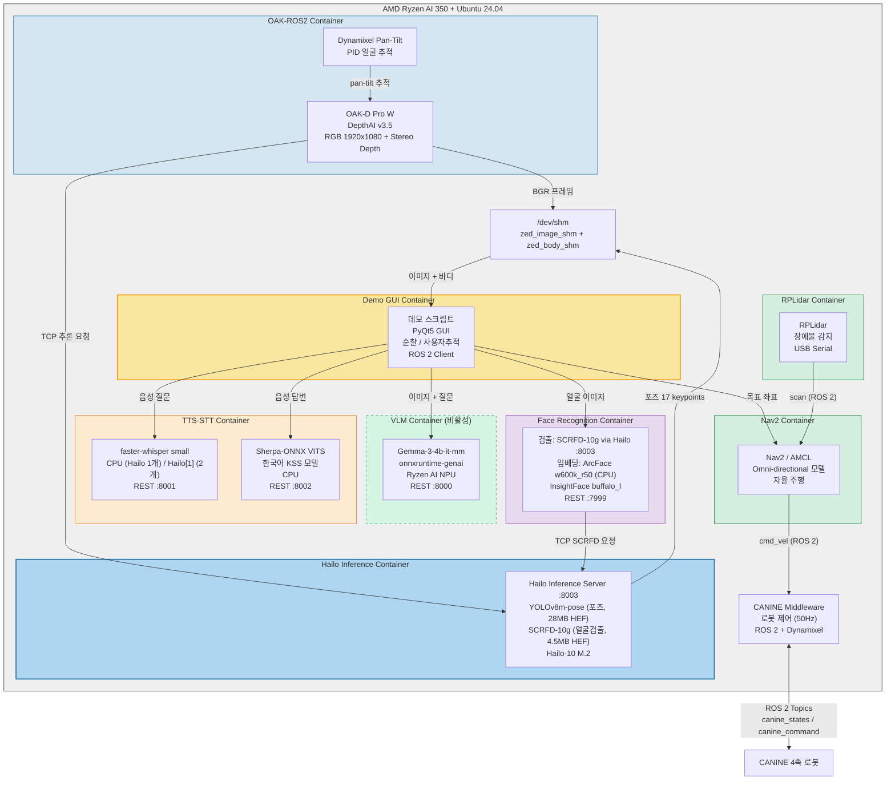

# ETRI-OpenPathRobotics-KoreaUniv Demo

4족 보행 로봇에 카메라, AI, 음성, 내비게이션을 결합한 데모 시스템입니다.



---

## 이 시스템이 하는 일

1. **OAK-D Pro W 카메라**로 사람을 인식하고 추적합니다
2. **Hailo-10 AI 가속기**로 사람의 자세(포즈)를 실시간 분석합니다
3. **Pan-Tilt 서보**로 카메라가 사람의 얼굴을 자동으로 따라갑니다
4. **얼굴 인식**으로 등록된 사람을 식별합니다
5. **VLM(비전 언어 모델)**로 카메라에 보이는 장면을 설명합니다
6. **음성 합성/인식(TTS/STT)**으로 한국어 대화를 합니다
7. **Nav2 내비게이션**으로 로봇이 자율 주행합니다

---

## 대상 하드웨어

**AMD Ryzen AI 350** 기반 시스템 (Ubuntu 24.04)

```
┌─ Ryzen AI 350 ──────────────────────────────┐
│  CPU: AMD Zen 5 (메인 처리)                   │
│  NPU: XDNA2 내장 (VLM 추론)                  │
│                                              │
│  M.2 슬롯 #2: Hailo-10 (카메라 포즈 분석)      │
│                                              │
│  USB3: OAK-D Pro W 카메라                     │
│  USB:  RPLidar + Dynamixel 서보              │
└──────────────────────────────────────────────┘
```

| 구성 요소 | 모델 | 역할 |
|----------|------|------|
| **CPU/NPU** | AMD Ryzen AI 350 | 메인 처리 + VLM 추론 (내장 NPU) |
| **AI 가속기** | Hailo-10 ×1~2 (M.2) | 아래 자동 감지 표 참고 |
| **카메라** | OAK-D Pro W (USB3) | 광각 스테레오 영상 + 깊이 |
| **LiDAR** | RPLidar (USB) | 장애물 감지, 내비게이션 |
| **서보** | Dynamixel ×2 (USB) | Pan-Tilt 카메라 제어 |
| **로봇** | CANINE 4족 보행 로봇 | 이동 플랫폼 |
| **OS** | Ubuntu 24.04 | — |

### Hailo-10 자동 할당

서버 시작 시 Hailo 장치 수를 자동 감지하여 할당합니다. 설정 불필요.

| Hailo 장치 수 | device[0] | device[1] |
|-------------|-----------|-----------|
| **1개** | Pose(OAK) + Face(공유) | — (STT는 CPU) |
| **2개** | Pose(OAK) + Face(공유) | STT(Whisper) |

> **NVIDIA GPU/CUDA 불필요** — 모든 AI 추론은 Hailo-10, Ryzen AI NPU, 또는 CPU에서 수행됩니다.

---

## 1단계: 소프트웨어 설치

### 1-1. Docker 설치

```bash
# Docker가 없다면 설치
curl -fsSL https://get.docker.com | sh

# sudo 없이 Docker 실행 (재부팅 필요)
sudo usermod -aG docker $USER
sudo reboot

# 재부팅 후 확인
docker run hello-world
```

### 1-2. Python 가상환경 만들기 (Ubuntu 24.04 필수)

Ubuntu 24.04는 시스템 Python에 `pip install`을 직접 실행하면 에러가 납니다.
가상환경을 만들어서 사용합니다. **처음 한 번만 만들면 됩니다.**

```bash
# 가상환경 생성
python3 -m venv ~/opr-venv

# 활성화 (터미널을 열 때마다 실행)
source ~/opr-venv/bin/activate

# 활성화되면 프롬프트 앞에 (opr-venv)가 붙습니다
# 이후 pip install은 그냥 사용 가능
pip install <패키지명>
```

> **팁:** 매번 `source`를 치기 싫다면 `.bashrc`에 추가하세요:
> ```bash
> echo 'source ~/opr-venv/bin/activate' >> ~/.bashrc
> ```
>
> **참고:** Docker 컨테이너 내부에서는 가상환경이 필요 없습니다 (Dockerfile에서 자동 처리됨).

### 1-3. Git LFS 설치 및 파일 받기

이 프로젝트의 일부 파일(AI 모델 등)은 용량이 커서 Git LFS로 관리됩니다.

```bash
sudo apt install git-lfs
cd ~/Documents/OPR_ETRI_Demo   # 프로젝트 폴더로 이동
git lfs install
git lfs pull
```

### 1-4. OAK-D Pro W 카메라 설정

카메라를 **USB3 포트(파란색)**에 연결하세요. USB2(검은색)는 대역폭이 부족합니다.

```bash
# USB 권한 설정 (처음 한 번만)
echo 'SUBSYSTEM=="usb", ATTRS{idVendor}=="03e7", MODE="0666"' | sudo tee /etc/udev/rules.d/80-movidius.rules
sudo udevadm control --reload-rules && sudo udevadm trigger

# 카메라 인식 확인
lsusb | grep 03e7
# 출력 예: Bus 001 Device 005: ID 03e7:2485 Intel Movidius MyriadX
```

### 1-5. Hailo-10 설치 (M.2 슬롯 #2)

Hailo-10을 M.2 슬롯 #2에 장착한 후:

```bash
# HailoRT .deb 다운로드: https://hailo.ai/developer-zone/
# (버전 5.2.0 기준)

# PCIe 드라이버 postinst 스크립트 충돌 방지를 위해 --unpack 사용
sudo dpkg --unpack hailort_*.deb
sudo ldconfig

# Python 바인딩: hailort는 PyPI에 없으므로 wheel 파일 별도 필요
# developer-zone에서 Python wheel(.whl) 다운로드 후:
pip install hailort-*.whl

# 장치 인식 확인
hailortcli fw-control identify
# Device ID + 펌웨어 버전이 출력되어야 합니다 (예: 0000:e5:00.0, firmware 5.2.0)
# 서버 실행 시 Hailo 장치는 자동으로 감지됩니다
```

> **주의:** `sudo dpkg -i`(전체 설치) 대신 `sudo dpkg --unpack`을 사용하는 이유:
> HailoRT .deb의 postinst 스크립트가 PCIe 드라이버 모듈 빌드를 시도하는데,
> 커널 헤더 환경에 따라 실패할 수 있습니다. `--unpack`은 파일만 배치하고 스크립트는 건너뜁니다.
> 커널 드라이버는 이미 `hailo1x_pci` 모듈로 로드되어 있다면 별도 빌드 불필요합니다.

### 1-6. Hailo 모델 (자동 다운로드)

HEF 모델은 **서버 첫 실행 시 S3에서 자동으로 다운로드**됩니다. `hailo_model_zoo` CLI 설치 불필요.

> 자동 다운로드된 모델은 `hailo_models/` 폴더에 저장됩니다.

인터넷 없는 환경에서는 미리 직접 다운로드:

```bash
mkdir -p hailo_models/

# YOLOv8m-pose (28MB) — 포즈 추정
wget -O hailo_models/yolov8m_pose.hef \
  "https://hailo-model-zoo.s3.eu-west-2.amazonaws.com/ModelZoo/Compiled/v5.2.0/hailo10h/yolov8m_pose.hef"

# SCRFD 10g (4.5MB) — 얼굴 검출
wget -O hailo_models/scrfd_10g.hef \
  "https://hailo-model-zoo.s3.eu-west-2.amazonaws.com/ModelZoo/Compiled/v5.2.0/hailo10h/scrfd_10g.hef"
```

### 1-7. Ryzen AI SDK 설치 (NPU 가속 시, 선택사항)

VLM을 NPU로 가속하려면 AMD Ryzen AI SDK가 필요합니다. **없어도 CPU로 동작합니다.**

```bash
# 1. AMD Ryzen AI SDK 다운로드 (ryzen_ai-1.7.0 등)
# https://www.amd.com/en/developer/resources/ryzen-ai-software.html
# 다운로드한 .run 파일을 실행하면 /opt/ryzenai/에 설치됨

# 2. NPU 드라이버 로드
sudo modprobe amdxdna

# 3. NPU 장치 확인
ls /dev/accel/accel*
# 출력: /dev/accel/accel0

# 4. SDK wheels을 /opt/ryzenai/wheels/에 배치
#    VLM 컨테이너 시작 시 entrypoint.sh가 여기서 자동 설치합니다.
#    SDK 설치 시 자동 배치되지 않았다면 수동 복사:
sudo mkdir -p /opt/ryzenai/wheels
sudo cp ~/Downloads/ryzen_ai-1.7.0/*.whl /opt/ryzenai/wheels/

# 설치 확인
ls /opt/ryzenai/wheels/
# 필요한 파일들:
#   voe-*.whl
#   vitis_aie_essentials-*.whl
#   device_essentials_strx-*.whl
#   ryzenai_dynamic_dispatch-*.whl
#   onnxruntime_vitisai-*.whl
#   onnxruntime_genai_ryzenai-*.whl
```

VLM 컨테이너는 `/opt/ryzenai`를 읽기 전용으로 마운트합니다:
- `/opt/ryzenai/wheels/` → `entrypoint.sh`가 시작 시 Python wheels 자동 설치
- `/opt/ryzenai/venv/deployment/lib/` → `libryzen_mm.so` 등 런타임 공유 라이브러리 (`LD_LIBRARY_PATH`로 참조)

> **NPU 없이 CPU로 실행 시:** 이 단계를 건너뛰면 VLM이 CPU에서 동작합니다 (느리지만 기능 동일).

### 1-8. VLM 빌드 준비

VLM 컨테이너 빌드 시 모델은 **자동 다운로드**됩니다 (~4GB, Docker 레이어에 캐시).

AMD 모델은 커스텀 ONNX op(`CastAvx`)을 사용하므로, AMD의 `onnxruntime-genai-ryzenai` wheel이 필요합니다.
[Ryzen AI SDK](https://www.amd.com/en/developer/resources/ryzen-ai-software.html)에서 다운로드한 파일 중 복사:

```bash
# AMD의 wheel 2개를 VLM Docker 빌드 폴더에 복사
cp ~/Downloads/ryzen_ai-1.7.0/onnxruntime_vitisai-*.whl vlm/docker/
cp ~/Downloads/ryzen_ai-1.7.0/onnxruntime_genai_ryzenai-*.whl vlm/docker/
```

> **이 2개 파일이 없으면 빌드가 실패합니다.**
> - `onnxruntime_vitisai` — VitisAI execution provider (genai의 의존성)
> - `onnxruntime_genai_ryzenai` — AMD 커스텀 op(`CastAvx`) 포함 GenAI 런타임
>
> PyPI의 일반 `onnxruntime-genai`는 이 모델과 호환되지 않습니다.

### 1-9. NoMachine 설치 (원격 접속 시)

로봇 PC에 원격으로 접속하려면:

1. 로봇 PC와 내 PC 모두 [NoMachine](https://www.nomachine.com/) 설치
2. 같은 네트워크에서 NoMachine으로 접속
3. 접속 설정에서 **마이크/오디오 관련 설정 전부 끄기**

> **주의:** 로봇 PC에 모니터가 물리적으로 연결되어 있어야 합니다 (가상 모니터도 가능).

---

## 2단계: Docker 이미지 빌드

4개의 컨테이너를 순서대로 빌드합니다. **처음 한 번만 하면 됩니다.**

### 2-1. OAK-ROS2 컨테이너 (카메라 + 로봇 제어)

```bash
# HailoRT 파일을 빌드 폴더에 복사 (선택 — 없어도 빌드 가능, Hailo 비활성화 상태로 실행)
cp hailort_*.deb zed-ros2-workspace/docker/        # 드라이버 .deb
cp hailort-*.whl zed-ros2-workspace/docker/        # Python wheel (Hailo 추론에 필요)

cd zed-ros2-workspace/docker
./build.sh
# 약 10~20분 소요
cd ../..
```

> **.deb와 .whl 모두 필요합니다.** .deb는 HailoRT 시스템 라이브러리, .whl은 Python `hailo_platform` 바인딩입니다.
> 둘 다 [Hailo Developer Zone](https://hailo.ai/developer-zone/)에서 버전 5.2.0으로 다운로드하세요.

### 2-2. VLM 컨테이너 (비전 언어 모델)

```bash
# 사전 준비: 1-8단계에서 onnxruntime_genai_ryzenai wheel이 vlm/docker/에 복사되어 있어야 합니다
ls vlm/docker/onnxruntime_genai_ryzenai-*.whl  # 파일 확인

cd vlm/docker
./compose_up.sh
# 첫 빌드 시 모델 다운로드 포함 (~4GB) — 인터넷 속도에 따라 10~30분 소요
# 빌드가 끝나면 Ctrl+C로 종료
cd ../..
```

### 2-3. TTS-STT 컨테이너 (음성 합성/인식)

```bash
cd tts-stt/docker
./compose_up.sh
# 빌드가 끝나면 Ctrl+C로 종료
cd ../..
```

### 2-4. Face Recognition 컨테이너 (얼굴 인식)

```bash
# HailoRT .deb를 빌드 폴더에 복사 (Hailo 얼굴 검출 사용 시)
cp hailort_*.deb face-recognition/docker/

cd face-recognition/docker
./compose_up.sh
# 빌드가 끝나면 Ctrl+C로 종료
cd ../..
```

### 빌드 완료 후 재부팅 권장

```bash
sudo reboot
```

### (선택) Docker 이미지를 파일로 저장 — 오프라인 배포 시

인터넷이 없는 환경으로 옮길 때 빌드된 이미지를 파일로 내보낼 수 있습니다.

```bash
# 저장 (온라인 PC에서)
docker save vlm-ryzenai:latest | gzip > vlm-ryzenai.tar.gz

# 복원 (오프라인 PC에서)
docker load < vlm-ryzenai.tar.gz
```

> 모델 파일(`vlm/models/`)은 컨테이너 외부에 있으므로 별도로 복사해야 합니다.

---

## 3단계: 서버 실행

### 방법 A: 한 번에 모두 실행 (권장)

```bash
./run_all_servers.sh
```

8개의 서버가 tmux 분할 화면에서 동시에 시작됩니다:

| 패널 | 서버 | 포트 |
|------|------|------|
| 0 | VLM (Gemma-3-4b-it-mm) | 8000 |
| 1 | STT (Whisper 음성인식) | 8001 |
| 2 | TTS (한국어 음성합성) | 8002 |
| 3 | Face Recognition (얼굴인식) | 7999 |
| 4 | CANINE Middleware (로봇 제어) | — |
| 5 | LiDAR (장애물 감지) | — |
| 6 | Pan-Tilt (카메라 서보) | — |
| 7 | OAK-D Camera (영상 + 포즈) | — |

> **tmux 사용법:** `Ctrl+B` → 방향키로 패널 이동, `Ctrl+B` → `D`로 빠져나오기

### 방법 B: 하나씩 실행 (문제 해결 시)

각 서버를 별도 터미널에서 실행할 수 있습니다:

```bash
# 터미널 1: 카메라 서버
cd zed-ros2-workspace
./run_oak_server.sh

# 터미널 2: VLM
cd vlm
./run_vlm_server.sh

# 터미널 3: STT
cd tts-stt
./run_stt_server.sh

# 터미널 4: TTS
cd tts-stt
./run_tts_server.sh

# 터미널 5: 얼굴 인식
cd face-recognition
./run_face_recognition_server.sh
```

---

## 4단계: 서버 작동 확인

각 서버가 정상인지 터미널을 열어 확인합니다:

```bash
# 카메라 확인
cd zed-ros2-workspace/docker && ./exec.sh
python3 -c "
import sys; sys.path.insert(0, '/root/workspace/zed-ros2-workspace/clients')
from zed_client import ZedClient
c = ZedClient()
img = c.grab_image(timeout=2.0)
print('카메라 OK' if img is not None else '카메라 연결 실패')
c.close()
"
exit

# VLM 확인
curl http://localhost:8000/health

# STT 확인 (녹음 파일이 있다면)
# curl -X POST -F "audio=@test.wav" http://localhost:8001/transcribe

# TTS 확인
curl -X POST http://localhost:8002/speak -H "Content-Type: application/json" -d '{"text":"안녕하세요"}'

# 얼굴 인식 확인
curl http://localhost:7999/health
```

---

## 5단계: 데모 실행

### 공통 준비 (모든 데모에 필요)

1. [3단계](#3단계-서버-실행)에서 서버가 모두 켜져 있어야 합니다
2. **Middleware GUI**에서 로봇을 **Walk** 모드로 변경합니다
3. Twist republisher를 실행합니다:
   ```bash
   cd zed-ros2-workspace/docker && ./exec.sh
   cd /root/workspace/SLAM_Nav
   python repub_twist2canine.py
   ```

### 실외 데모: 사람 추적 (간단, 맵 불필요)

로봇이 카메라 앞의 사람을 따라다닙니다.

```bash
# 터미널 A: Nav2 실행
cd zed-ros2-workspace
./run_nav2_outdoor.sh

# 터미널 B: 데모 GUI 실행
cd zed-ros2-workspace/docker && ./exec.sh
cd /root/workspace/demo
python _22_usertracking_gui.py
```

### 실내 데모: 순찰 + 얼굴 인식 (맵 필요)

로봇이 정해진 경로를 순찰하면서 사람을 만나면 인식합니다.

> **사전 준비:**
> - 실내 맵이 필요합니다. 맵 만드는 방법은 [docs/slam-map.md](docs/slam-map.md) 참고
> - 얼굴 인식에는 사전 등록이 필요합니다: [docs/face-recognition-container.md](docs/face-recognition-container.md) 참고

```bash
# 터미널 A: Nav2 실행 (실내 맵 사용)
cd zed-ros2-workspace
./run_nav2_indoor.sh

# 터미널 B: 키보드로 로봇 위치 초기화
cd zed-ros2-workspace/docker && ./exec.sh
cd /root/workspace/SLAM_Nav
python keyboard_teleop.py
# RViz에서 로봇 위치가 맞으면 Ctrl+C

# 터미널 C: 데모 GUI 실행
cd zed-ros2-workspace/docker && ./exec.sh
cd /root/workspace/demo
python _21_patrol_gui.py
```

### VLM 데모: 장면 설명

카메라에 보이는 것을 AI가 설명합니다.

```bash
cd zed-ros2-workspace/docker && ./exec.sh
cd /root/workspace/demo
python _20_vlm_gui.py
```

---

## 종료 방법

```bash
# 모든 컨테이너 한 번에 종료
./kill_docker.sh

# ROS 2 노드만 종료
./kill_ros2_node.sh
```

---

## 문제 해결

### 카메라가 안 된다

| 증상 | 해결 |
|------|------|
| `No DepthAI device found` | USB3 포트(파란색)에 연결했는지 확인. `lsusb \| grep 03e7`으로 인식 확인 |
| 화면이 까맣다 | USB 케이블 교체. 전원 부족일 수 있음 |
| FPS가 20 이하 | USB2에 꽂혀 있음 → USB3로 변경 |

### Hailo-10이 안 된다

| 증상 | 해결 |
|------|------|
| `hailo_platform import error` | `hailort`는 PyPI 미등록. developer-zone에서 wheel(.whl) 다운로드 후 `pip install hailort-*.whl` |
| `hailortcli`에서 장치 안 보임 | `lspci \| grep Hailo`로 PCIe 인식 확인. M.2 슬롯 #2 재장착 |
| `dpkg -i` 설치 실패 (postinst 오류) | `sudo dpkg --unpack hailort_*.deb && sudo ldconfig` 사용 |
| HEF 로드 실패 / 아키텍처 불일치 | `hailo_models/` 폴더에 `hailo10h` 전용 HEF가 있는지 확인. S3 URL로 재다운로드 |
| `HAILO_NOT_IMPLEMENTED` (error 7) | HailoRT 4.x API(`ConfigureParams`) 사용 중. 5.x `InferModel` API 필요. 버전 확인: `hailortcli fw-control identify` |

### VLM이 안 된다

| 증상 | 해결 |
|------|------|
| 모델 다운로드 실패 | 인터넷 연결 확인. HuggingFace 계정 로그인 필요할 수 있음 |
| `VitisAI EP not available` | AMD Ryzen AI SDK 설치 확인. `sudo modprobe amdxdna` 실행 |
| 응답이 매우 느림 | NPU 미사용 중 (CPU fallback). Ryzen AI SDK 설치 확인 |

### 카메라 파이프라인 오류

| 증상 | 해결 |
|------|------|
| `Camera board socket already used` | DepthAI v3에서는 `StereoDepth.build(autoCreateCameras=True)`로 스테레오 카메라를 생성. CAM_B/CAM_C를 직접 `pipeline.create()`로 만들면 충돌 |
| `Disparity/depth width must be multiple of 16` | `stereo.setDepthAlign(CAM_A)` 사용 시 발생. OAK-D Pro W RGB ISP 네이티브 폭(2024px)이 16의 배수가 아님. depth align 없이 사용 |
| `XLinkOut not found` | DepthAI 3.x에서 `XLinkOut` 노드 제거됨. `cam.requestOutput()` + `queue.createOutputQueue()` 방식으로 대체 |

### 카메라 shared memory 끊김

Main script 종료 후 카메라 서버를 재시작해야 합니다:

```bash
cd zed-ros2-workspace
./run_oak_server.sh
```

### LiDAR / Pan-Tilt이 안 된다

USB를 뽑았다가 다시 꽂은 후:

```bash
cd zed-ros2-workspace && ./run_lidar.sh     # LiDAR 재시작
cd zed-ros2-workspace && ./run_pantilt.sh   # Pan-Tilt 재시작
```

### 컨테이너에 직접 들어가기

문제를 직접 확인하고 싶을 때:

```bash
# OAK-ROS2 컨테이너
cd zed-ros2-workspace/docker && ./exec.sh

# VLM 컨테이너
cd vlm/docker && ./exec.sh

# TTS-STT 컨테이너
cd tts-stt/docker && ./exec.sh

# Face Recognition 컨테이너
cd face-recognition/docker && ./exec.sh
```

---

## 시스템 구조 요약

```
┌─ AMD Ryzen AI 350 + Ubuntu 24.04 ──────────────────────────────────────┐
│                                                                         │
│  ┌─ OAK-ROS2 Container ──────────┐  ┌─ TTS-STT Container ───────────┐ │
│  │ OAK-D Pro W Camera             │  │ TTS (Sherpa-ONNX)    :8002    │ │
│  │ Hailo Inference Server  :8003  │  │ STT (Whisper)        :8001    │ │
│  │  ├─ yolov8m_pose (포즈)        │  │ CPU / Hailo[1] 자동            │ │
│  │  └─ scrfd_10g   (얼굴 검출)    │  └───────────────────────────────┘ │
│  │ Nav2 / AMCL                    │                                     │
│  │ CANINE Middleware              │  ┌─ Face Recognition Container ──┐ │
│  │ LiDAR + Pan-Tilt              │  │ InsightFace ArcFace    :7999   │ │
│  └────────────────────────────────┘  │ 검출: Hailo (via :8003)       │ │
│                                       │ 임베딩: CPU                    │ │
│  ┌─ VLM Container ───────────────┐  └───────────────────────────────┘ │
│  │ Gemma-3-4b-it-mm       :8000  │                                     │
│  │ Ryzen AI NPU / CPU fallback   │  ┌─ /dev/shm ────────────────────┐ │
│  └────────────────────────────────┘  │ zed_image_shm (BGR 1920×1080) │ │
│                                       │ zed_body_shm  (포즈 트래킹)    │ │
│          ▲ ROS 2 Topics               └───────────────────────────────┘ │
│          │ canine_states / canine_command                                │
└──────────┼──────────────────────────────────────────────────────────────┘
           │
     🦿 CANINE 4족 로봇
```

---

## 사용 AI 모델 목록

이 시스템에서 사용하는 모든 AI 모델입니다. Hailo HEF 모델은 서버 첫 실행 시 **자동 다운로드**됩니다.

| 용도 | 모델 | 크기 | 형식 | 실행 장치 | 다운로드 |
|------|------|------|------|----------|---------|
| **포즈 추정** | YOLOv8m-pose (COCO-17) | 28MB | HEF | Hailo-10 [0] | 자동 (`hailo_models/yolov8m_pose.hef`) |
| **얼굴 검출** | SCRFD 10g | 4.5MB | HEF | Hailo-10 [0] (공유) | 자동 (`hailo_models/scrfd_10g.hef`) |
| **얼굴 임베딩** | InsightFace ArcFace (buffalo_l) | ~330MB | ONNX | CPU | 자동 (`~/.insightface/`) |
| **VLM** | Gemma-3-4b-it-mm | ~4GB | ONNX | Ryzen AI NPU | 수동 ([1-8단계](#1-8-vlm-모델-다운로드)) |
| **음성 인식 (STT)** | Whisper small (faster-whisper) | ~460MB | CTranslate2 | CPU (1개) / Hailo-10 [1] (2개) | 자동 (`~/.cache/whisper/`) |
| **음성 합성 (TTS)** | Sherpa-ONNX VITS 한국어 (KSS) | ~50MB | ONNX | CPU | Git LFS (`tts-stt/tts_model/`) |

### 하드웨어별 모델 할당

```
Ryzen AI NPU ─── Gemma-3-4b-it-mm (VLM)

                 ┌─ Hailo Inference Server (TCP :8003) ─┐
Hailo-10 [0] ───┤  YOLOv8m-pose (매 프레임, 상시)         │
                 │  SCRFD 10g (얼굴 감지 시, 간헐)          │
                 │  ← oak_server, face_recognition 공유    │
                 └─────────────────────────────────────────┘

Hailo-10 [1] ─── Whisper encoder (2개일 때만, 없으면 CPU)

CPU ─────────┬─ InsightFace ArcFace (얼굴 임베딩)
             ├─ Sherpa-ONNX VITS (TTS)
             ├─ Whisper decoder (STT, Hailo 사용 시)
             └─ faster-whisper (STT, Hailo 없을 때)
```

### 모델 다운로드 위치 요약

| 모델 | 저장 경로 | 비고 |
|------|----------|------|
| YOLOv8m-pose HEF | `hailo_models/yolov8m_pose.hef` | 첫 실행 시 자동 |
| SCRFD 10g HEF | `hailo_models/scrfd_10g.hef` | 첫 실행 시 자동 |
| Gemma-3-4b-it-mm | `vlm/models/Gemma-3-4b-it-mm-onnx-ryzenai-npu/` | 수동, ~4GB |
| Whisper | `~/.cache/whisper/` (호스트) | 첫 실행 시 자동, ~460MB |
| InsightFace buffalo_l | `~/.insightface/` (컨테이너 내) | 첫 실행 시 자동, ~330MB |
| 한국어 TTS VITS | `tts-stt/tts_model/sherpa-onnx-korean-tts/` | Git LFS |

> **오프라인 환경:** 인터넷이 없는 곳에서 실행하려면 위 경로에 모델을 미리 복사해 두세요.

---

## 각 컨테이너 상세 문서

| 컨테이너 | 문서 |
|----------|------|
| **OAK-ROS2** | [docs/zed-ros2-container.md](docs/zed-ros2-container.md) ※ 폴더명 `zed-ros2-workspace`는 레거시 |
| **VLM** | [docs/vlm-container.md](docs/vlm-container.md) |
| **TTS-STT** | [docs/tts-stt-container.md](docs/tts-stt-container.md) |
| **Face Recognition** | [docs/face-recognition-container.md](docs/face-recognition-container.md) |
